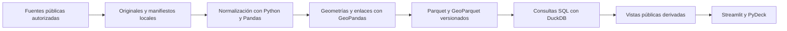

# Arquitectura propuesta

Estado al 22/10/2026: ingesta municipal oficial de sesión 1 completada; sesión 2 implementa auditoría, integración por niveles, límites distritales oficiales y aplicación Streamlit/PyDeck local. La cobertura física certificado–BU permanece sin acreditar. Véanse [metodología](integracion_ceee_catastro.md) y [resultados](sesion_2.md). Las capas ajenas a Catastro/CEEE y el despliegue no forman parte de esta sesión.

La implementación actual usa Pandas, PyArrow, Shapely y PyProj; conserva WKT/CRS en Parquet convencional y genera GeoJSON únicamente para dibujar el piloto. GeoPandas, GeoParquet y DuckDB del diagrama siguiente son opciones del diseño general, no dependencias del flujo implementado. El análisis ocurre fuera del proceso Streamlit; la aplicación lee productos locales verificados por hash.

## Evolución de presentación · sesión 3

La aplicación mantiene resultados de sesión 2 de solo lectura y verifica hashes. PolygonLayer conserva la identidad BU en cada miembro y devuelve selección nativa a un estado independiente del índice. Se añaden tres pestañas, fondo raster OSM opcional y filtros temporales. No cambian el modelo de integración ni los Parquet. Sin dependencias nuevas. La aceptación en navegador está bloqueada por permisos; véanse [sesión 3](sesion_3.md) y [decisión cartográfica](componente_cartografico.md).

## Flujo y responsabilidades



La extracción y transformación se ejecutarán fuera del proceso web. Streamlit leerá una versión publicada y acotada; no consultará los registros administrativos por cada usuario. DuckDB consultará Parquet y podrá materializar una base local; GeoParquet conservará geometría y CRS. Validar soporte espacial y dependencias después de aprobar el desarrollo.

## Modelo lógico preliminar

Los nombres siguientes son propuestas internas, no nombres de columnas oficiales.

| Entidad | Grano y claves propuestas |
| --- | --- |
| `source_snapshot` | Fuente, URL, consulta, fecha de captura, corte de datos, licencia, hash |
| `parcel` | Parcela y `parcel_ref14`, con versión temporal |
| `building` / `building_part` | Objeto BU y partes; identificador original y geometría |
| `address` / `building_address` | Portales y relación explícita con objetos/parcela |
| `energy_certificate` | Certificado y ámbito: edificio, vivienda, otra parte o desconocido |
| `certificate_reference` | Relación entre certificado y cada RC original |
| `inspection_event` | ITE/IEE, resultado, fechas y subsanación si son publicables |
| `enforcement_event` | Orden, estado y cumplimiento confirmados |
| `grant` / `grant_building` | Concesión, programa e importes con alcance y enlaces múltiples |
| `administrative_area` | Polígono de barrio/distrito, código y vigencia |
| `match_evidence` | Método, confianza, ambigüedad y revisión de cada enlace |

No usar RC14 como sinónimo universal de bloque físico. Conservar la RC de inmueble completa y la identidad de origen; si la fuente solo permite parcela, mostrar ese alcance. No inventar desagregación de superficies, importes o certificados.

## Normalización y calidad

1. Guardar identificadores como texto; normalizar espacios y mayúsculas preservando originales.
2. Separar referencias múltiples; validar formato y municipio. No resolver automáticamente referencias contradictorias.
3. Priorizar RC explícita, después dirección/portal validado y finalmente evidencia espacial revisable. No enlazar solo por proximidad.
4. Trabajar en EPSG:25830 para áreas y cruces; exportar EPSG:4326 para el mapa. Documentar el CRS de cada origen.
5. Mantener eventos históricos; definir la observación vigente por ámbito y fecha, sin sobrescribir certificados de viviendas con certificados del bloque.
6. Resolver relaciones muchos-a-muchos antes de agregar, evitando multiplicar superficies o euros por uniones SQL.

Un nulo significa desconocido. Mantener estados distintos para fuente no consultada, sin coincidencia y dato no publicable. Exponer fecha, procedencia y confianza junto a cada indicador. Los indicadores de potencial serán explicables y versionados; el diseño actual no fija una fórmula.

## Organización futura

```text
src/madrid_rehab/       # Adaptadores, transformación, cruces y consultas
tests/                 # Contratos de datos y casos de enlace
docs/                  # Investigación y decisiones
data/raw/              # Originales locales; fuera de Git público
data/processed/        # Parquet/GeoParquet reproducibles
data/public/           # Productos revisados para publicación
```

`src/madrid_rehab/`, `tests/`, `data/raw/` y `data/processed/` existen para el pipeline inicial. `data/public/` sigue siendo una propuesta. GitHub versionará código, documentación, contratos y manifiestos sin secretos; los datos locales están excluidos mediante `.gitignore`. Los datasets grandes tendrán almacenamiento y política de distribución separados, pendientes de decidir. No considerar el disco de la aplicación como almacén maestro.

## Presentación y despliegue futuros

Streamlit ofrecerá filtros y fichas; PyDeck, geometrías simplificadas para visualización y carga limitada al ámbito seleccionado. Separar mapas de conservación, energía y ayudas, con leyendas que indiquen disponibilidad. La vista pública conservará edificios sin certificados y sin ayudas localizadas.

Community Cloud permite [seleccionar repositorio, rama y punto de entrada](https://docs.streamlit.io/deploy/streamlit-community-cloud/deploy-your-app/deploy). Antes de publicar: fijar versiones, medir memoria y rendimiento, verificar licencias del mapa base y atribuciones. Las [limitaciones oficiales](https://docs.streamlit.io/deploy/streamlit-community-cloud/status) indican alojamiento en EE. UU.; evitar cargar datos personales innecesarios.

La separación entre procesamiento, consultas y presentación permitirá evaluar FastAPI y MapLibre más adelante, sin comprometer ahora endpoints ni infraestructura adicional.
