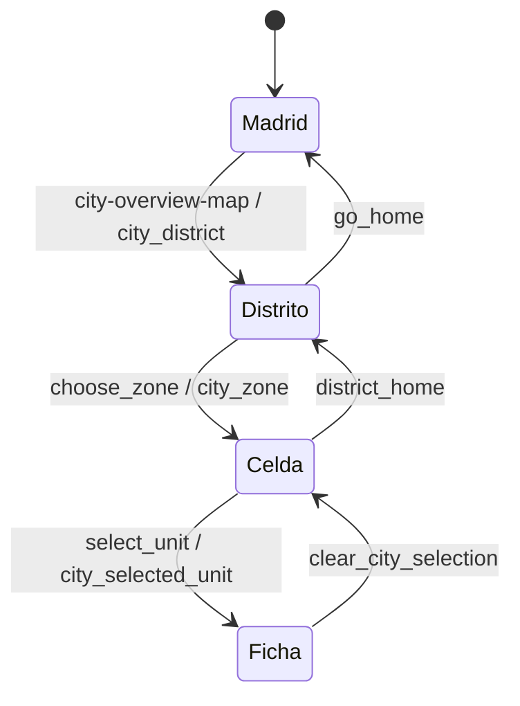
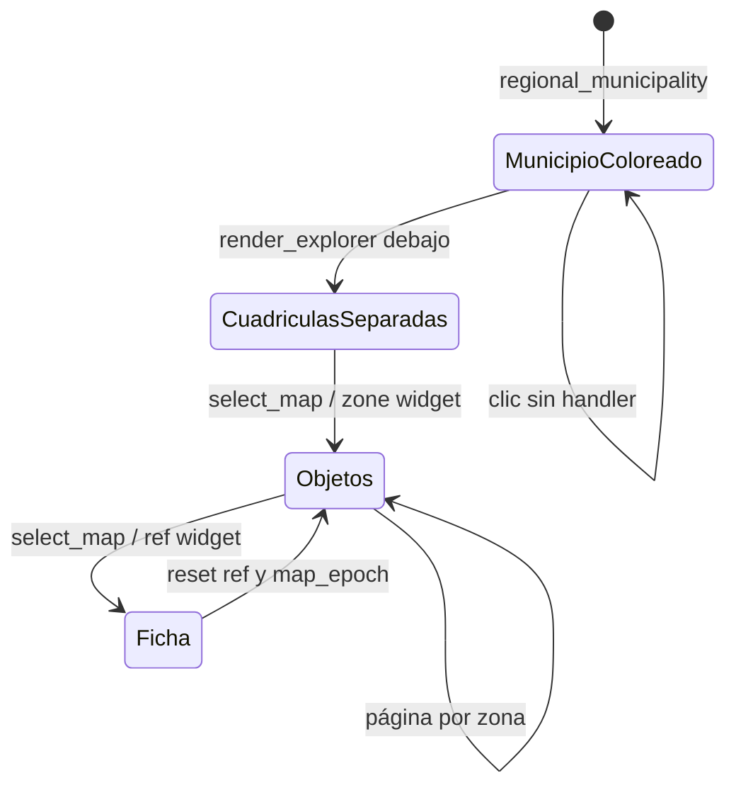
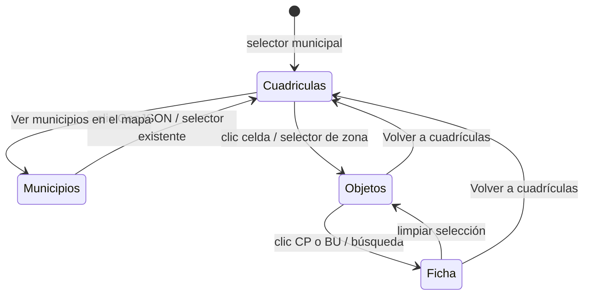

# Auditoría previa a la corrección (26 octubre 2026)

Se leyeron AGENTS.md, documentación de navegación, app, city_app, city_maps,
district_view, regional_view, municipal_navigation, municipal_fiche, map_view,
demo y pruebas municipales/regionales/distritales. Estado previo preservado en
reports/municipal_navigation/diagnosis_02/status_before.txt. Los cambios locales
incluyen navegación compartida, demo, REC, conservación y energía; no se revierten.

## Estados anteriores





A: demostrado en código: render_regional dibuja geometry_deck sin key/on_select.
Pickable en la capa permite picking de deck.gl pero no entrega eventos al backend
si st.pydeck_chart mantiene on_select=ignore. El selector ya renderiza otro mapa.
C: demostrado: mapa territorial incondicional seguido del explorador; controles y
paneles regionales ocupan el mismo recorrido vertical. La entrada normal y la vista
regional además son envoltorios diferentes del explorador.

B: NO demostrada aún en navegador. Ambas RC14 8727902VK6882N y 4731501VK6843S
son filas únicas aceptadas de 28005, geometría utilizable e índice presente,
respectivamente zonas 468:4482 y 464:4483. No procede cambiar datos.
El parser espera selection.objects[layer][].properties.unit_id (GeoJSON) o unit_id
(PolygonLayer). El callback captura frame/zone de la última ejecución y escribe
el mismo estado del text_input; la ficha usa ref/cp calculados al inicio del rerun.
Hipótesis pendientes: evento no entregado/descartado, claves dependientes del caso
initial_ref, selección obsoleta tras cambio de página/zona/municipio y limpieza de
widgets. No hay guardia de municipio activo en el callback compartido, a diferencia
de select_unit de Madrid. La selección se almacena exclusivamente en un widget;
no hay estado de dominio independiente. Cambiar initial_ref cambia todas las claves.
La prueba anterior llama picked y después escribe text_input: no prueba el callback.

Streamlit instalado 1.50.0: PydeckSelectionSerde deserializa JSON, callback se ejecuta
antes del rerun; identidad del widget incluye spec, aun con key explícita. No se
puede escribir el estado de selección del chart. Capas tienen id explícito y
pickable=True. Se necesita prueba enviando WidgetStates.string_value al chart
real y pasando por deserialización/callback/rerun; no equivale a clic WebGL.

## Eventos y cambios propuestos

Conservar identidad municipal y selección de dominio separadas de widgets. Un mapa
principal sustituye territorio por cuadrículas y después por objetos. Selector y
clic territorial abren cuadrículas. Volver limpia objeto, conserva municipio;
limpiar renueva epoch del chart para poder volver a seleccionar el mismo objeto.
Página/zona/tipo/municipio invalidan selección previa. Selección válida debe cargar
por identificador estable y producir ficha o error explícito. Madrid histórico
mantiene su flujo y lectores; Madrid compartido usa la misma navegación de pilotos.

## Implementación aplicada



Solo uno de los mapas se renderiza en cada nivel. La vista regional ya no dibuja
el mapa municipal inerte encima del explorador. Madrid en el explorador compartido
usa las mismas celdas que los pilotos; la vista histórica de 21 distritos conserva
su navegación, fichas y NDP/REC. Los paneles regionales posteriores se conservan.

`municipal_active_context = (municipality_code, prefix)` invalida callbacks de otro
municipio/tipo. Las claves del explorador ya no dependen de `initial_ref`. El estado
`prefix_selected` es independiente del widget `prefix_ref`; tanto búsqueda como
callback actualizan la selección. Al reaparecer el widget se restaura desde ese
estado. El chart tiene clave por zona/página/epoch; limpiar renueva epoch sin
escribir en la selección read-only del chart. Cambiar zona/página limpia objeto;
cambiar municipio/tipo elimina estado previo. Volver conserva municipio y limpia
objeto. La búsqueda localiza celda y página exactas.

El contrato de selección usa las Features reales serializadas en `chart.proto.json`,
con sus propiedades `unit_id`. La prueba envía `WidgetStates.string_value` al ID
registrado del chart, pasa por `PydeckSelectionSerde`, ejecuta el callback y el
rerun de Streamlit. No escribe una referencia en el buscador como sustituto del
evento. `apply_map_event` valida municipio/contexto y allowlist de identidades
visibles. La ficha carga `selected_object(code, selected, kind)` y renderiza los
seis apartados existentes en la columna contigua. Una búsqueda no recuperable
produce mensaje de error explícito. CP y BU se exploran en capas separadas para
no confundir objetos superpuestos ni fabricar relaciones.

**Límite de diagnóstico B:** se han corregido riesgos demostrables de persistencia
(claves dependientes de referencia inicial, estado exclusivamente de widget,
callbacks sin guardia municipal, selección obsoleta al cambiar zona/página). No se
ha reproducido el panel vacío de la observación humana mediante clic real ni se
puede atribuir a uno de esos riesgos como causa raíz confirmada. Ambas referencias
funcionan en el contrato completo backend. La causa concreta de la observación
WebGL sigue pendiente de la prueba externa; no se declara el problema B resuelto.

## Archivos de esta intervención

- `municipal_navigation.py`: transición y estado compartidos, mapa territorial,
  selección independiente, vuelta, limpieza, paginación y error explícito.
- `regional_view.py`: quitar mapa inerte duplicado, integrar entrada compartida y
  contorno de selección.
- `demo.py`: conectar la entrada existente al mismo mapa por niveles, sin nueva demo.
- `tests/test_municipal_map_events.py`: contrato serializado, seis recorridos CP/BU,
  limpieza/reselección, páginas, casos Alcalá, eventos obsoletos y captura vacía.
- `tests/test_municipal_navigation.py`: comprobar incremento de epoch respecto al
  anterior, porque búsqueda y cambio de zona también invalidan eventos ahora.
- `tests/browser_municipal_navigation.py`: municipio → celda → CP/BU mediante ratón,
  cambio de objeto, limpieza/reselección, regreso y búsquedas Alcalá.
- Esta auditoría y enlace de actualización en documentación/README.

No se modificaron originales, Parquet, snapshots ni reglas de enlace. No commits,
push ni descargas. `municipal_fiche.py`, energía, PRTR, conservación y REC no se
modificaron en esta intervención.

## Validación fuera del sandbox, en Ubuntu

Desde el directorio del proyecto, con el entorno y navegador ya instalados, terminal 1:

```bash
cd /home/apalo/madrid-rehab-intelligence
MADRID_REHAB_OFFLINE=1 PYTHONPATH=src .venv/bin/python -m streamlit run src/madrid_rehab/app.py --server.address 127.0.0.1 --server.port 8512
```

Terminal 2 (usar otra salida si ya existe):

```bash
cd /home/apalo/madrid-rehab-intelligence
PLAYWRIGHT_BROWSERS_PATH=/tmp/madrid-rehab-browser PYTHONPATH=src .venv/bin/python tests/browser_municipal_navigation.py --output-dir reports/municipal_navigation/browser_ubuntu_02
```

Si Chromium está instalado en otro lugar, ajustar PLAYWRIGHT_BROWSERS_PATH al
existente. La prueba no instala ni descarga navegadores. Examinar `browser.json`
y capturas; un exit 2 representa bloqueo o fallo, nunca validación satisfactoria.

Revisión humana en `http://127.0.0.1:8512`:

1. En Explorar municipios, pulsar Ver municipios en el mapa; seleccionar cada uno
   de Madrid, Getafe, Móstoles, Leganés, Alcorcón y Alcalá mediante el polígono.
2. Comprobar que el mismo espacio muestra cuadrículas. Pulsar una celda y después
   una parcela; ficha contigua con seis pestañas y contorno azul.
3. Elegir otra parcela; limpiar y pulsar la anterior; comprobar que cambia ficha.
   Cambiar página si hay más de 500 objetos y comprobar que se limpia la selección.
4. Cambiar a Objetos BU independientes, elegir celda/objeto, comprobar ficha y
   ausencia de atribución de relaciones CP–BU no acreditadas en pilotos.
5. Volver a cuadrículas y municipios; cambiar municipio sin referencias residuales.
6. En Alcalá buscar 8727902VK6882N (468:4482) y 4731501VK6843S (464:4483), limpiar y
   pulsar cada polígono. Confirmar seis apartados, municipio y referencia correctos.
7. Abrir CEEE/PRTR/conservación donde hay evidencias existentes. Probar también
   Comunidad de Madrid → mismo recorrido. En Madrid capital (Analista), probar
   distrito/celda/objeto y accesos NDP/REC sin ejecutar consultas externas.

El entorno Codex falla al crear socket TCP (`PermissionError`, errno 1); Chromium
aborta al arrancar en `sandbox_host_linux.cc` (`Operation not permitted`). Evidencias:
`reports/municipal_navigation/diagnosis_02/server_block.txt` y
`reports/municipal_navigation/diagnosis_02/browser/browser.json`. No se acredita
clic WebGL, superposición real, revisión visual ni aceptación A–F completa.

## Resultados ejecutados

| Municipio | Contrato municipio → celda → CP/BU → ficha → limpiar/reseleccionar → volver | Ratón WebGL |
|---|---|---|
| Madrid | Superado | Bloqueado |
| Getafe | Superado | Bloqueado |
| Móstoles | Superado | Bloqueado |
| Leganés | Superado | Bloqueado |
| Alcorcón | Superado | Bloqueado |
| Alcalá de Henares | Superado | Bloqueado |

Ambas RC14 de Alcalá están aceptadas, con geometría e índice: búsqueda abre zona y
página correctas; evento serializado de su Feature carga ficha completa, conserva
28005 y actualiza `municipal_28005__cp_selected`; limpiar/reseleccionar funciona.
Los seis apartados se renderizan, aunque no todos contienen evidencia disponible.

- `map_events.log`: 4 pruebas OK, incluyendo seis recorridos con las Features de
  los mapas reales (122,982 s). Incluye CP/BU, dos objetos, páginas, contexto obsoleto,
  referencias Alcalá y error explícito para búsqueda inválida.
- `regressions.log`: 70 pruebas ejecutadas. 69 superadas; la restante falló en sus
  seis subcasos por esperar epoch absoluto 1, ahora 3 por las invalidaciones de
  zona y búsqueda. Se ajustó la aserción a comprobar incremento de uno al limpiar.
  Este log se conserva con sus fallos, sin presentarlo como una ejecución verde.
- `final_focused.log`: 3 pruebas OK tras ese ajuste (63,294 s): prueba municipal
  restante con seis fichas CP/BU, ambas referencias Alcalá y cobertura vacía sin
  chart. No se repitió toda la suite. La prueba de captura vacía complementa el
  caso de celda sin objetos: las celdas vacías no se ofrecen en el índice real.
- Las 69 regresiones incluyen renderizado de los 21 distritos, detalle CP/BU
  histórico, filtros, páginas CP exhaustivas sin pérdida por 500, productos
  energía/PRTR de la misma captura, conservación y NDP/REC con red simulada/local,
  y protecciones públicas. No se realizaron consultas REC externas.
- Ruff `check src tests`: OK; `git diff --check`: OK.

Logs bajo `reports/municipal_navigation/diagnosis_02/`. No se declara aceptación
visual ni tarea plenamente completada: falta ejecutar la prueba externa y
reproducir/descartar específicamente el panel vacío observado por el usuario.
