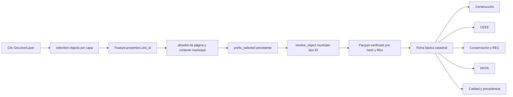

# Sesión 16: fichas CP/BU

## Alcance y diagnóstico

Partida: árbol limpio, commit f25cb5c. Se revisaron AGENTS.md, entrada
Streamlit, navegación compartida, fichas, lectores demo/regionales/distritales,
índice, eventos, energía, conservación y PRTR, documentación y pruebas previas.
No se descargó ni reprocesó Catastro ni se modificaron snapshots.

Causa **demostrada por reproducción con fallo inyectado**, no atribuida sin
evidencia a todos los clics observados por el usuario: Identificación consultaba
accesos de conservación sin aislamiento. Una excepción detenía la ficha antes
de construir el resto de contenidos. Construcción, energía y PRTR también podían
interrumpir los apartados siguientes. Comparación ejecutada contra el código del
commit original: conservación inaccesible provoca 1 excepción y 0 tablas; con
la corrección, 0 excepciones y 3 tablas, con avisos específicos. Véase
reports/session_16/reproduction.log. Las seis pestañas se declaraban de antemano:
contarlas sin comprobar sus contenidos no detectaba el fallo.

También se detectó que una captura CEEE ausente terminaba silenciosamente el
apartado: ahora declara consulta no realizada. BU Madrid usaba automáticamente
parcel_ref14 como permiso para mostrar evidencias CP; se conserva el atributo
original pero la ficha BU permanece independiente hasta disponer de acreditación
explícita de esa relación. No se modifica ningún vínculo en los productos.

No se demuestra un fallo de entrega WebGL: las capas son pickable, tienen ID
regional-geometries, on_select callable y single-object. Solo hay una capa
seleccionable; las Features llevan unit_id persistente. No se utiliza el índice
del DataFrame. Las dos referencias obligatorias de Alcalá existen y superan el
contrato serializado completo. La ausencia de esas filas o su cuarentena quedan
descartadas como causa para esos dos casos. La causa concreta de un clic humano
sin ficha sigue pendiente de observación en navegador.

## Dependencias e identidad



Identidad de dominio: (municipality_code, cp|bu, identificador).
CP normaliza espacios externos y mayúsculas; admite las 14 posiciones
alfanuméricas de las identidades históricas conservadas. No impone el patrón
urbano de conservación a toda CP: Madrid conserva otras referencias documentales.
La validación sintáctica no acredita existencia ni aceptación. BU conserva su
identificador original con distinción de mayúsculas.

El lector filtra por parcel_ref14 o building_id, exige una sola fila y geometría
utilizable, comprueba municipality_code cuando existe y selection_status cuando
está disponible. Distingue inválido, ausente, ambiguo, municipio incompatible,
no utilizable y error de lectura. Nunca selecciona una fila de una ambigüedad.
Madrid usa los productos históricos autenticados; pilotos, las cinco particiones
aceptadas de session_12_2_partial_validated_01.

## Estado y propagación

El callback se ejecuta antes del rerun y comprueba municipal_active_context y los
IDs visibles. prefix_selected conserva selección fuera del text_input; prefix_ref
es el widget sincronizado. Municipio y tipo delimitan el namespace. Zona/página
limpian el objeto; limpiar renueva map_epoch y permite seleccionar de nuevo el
mismo objeto. No se escribe el estado read-only del chart. La ficha se recalcula
desde la identidad actual; no reutiliza datos de la ficha anterior.

Se preserva la navegación existente; no se añade buscador ni mapa.
La entrada normal es app → city_app → explorador compartido. El analista
histórico mantiene district_view/city_store y sus 21 distritos.

## Ficha y errores parciales

Identificación aparece antes de las consultas auxiliares: municipio, identidad,
fuente Catastro INSPIRE, geometría utilizable, punto interior EPSG:25830 y
validación. Las seis pestañas mantienen orden:
Identificación; Características constructivas; Certificados CEEE;
Conservación e ITE/IEE; Subvenciones PRTR; Calidad, limitaciones y procedencia.

Cada apartado tiene una frontera de error con logging y aviso de consulta fallida.
La excepción no se transforma en ausencia de evidencias. Las funciones secundarias
existentes siguen declarando cobertura, fuentes ausentes y restricciones públicas.
Un fallo en accesos no borra identificación. El estado técnico de cada apartado
se reinicia para cada ficha y refleja errores interceptados. Conservación registra
también sus errores internos. No se realiza consulta REC externa al abrir ficha.

BU muestra sus atributos propios, incluidos Building/BuildingPart cuando existen.
No se heredan certificados, subvenciones ni conservación por contención/proximidad
ni por un campo incidental. Se informa de la ausencia de relación documental.
No se confirma un edificio físico. Importes pertenecen al expediente, no al enlace.

## Casos y cobertura contrastados

reports/session_16/real_cases.json enumera 24 identidades reales (12 CP, 12 BU),
dos de cada tipo por municipio y celdas distintas. Incluye 8727902VK6882N y
4731501VK6843S, y Madrid 0010510VK4701A con evidencias históricas.
Cada caso atraviesa índice → página → Feature serializada del chart →
deserializador Streamlit → callback → persistencia → lector → identidad y seis
apartados. Las pruebas comparan contenidos e identidades, no solo excepciones.

reports/session_16/integrity.json contrasta exhaustivamente los doce productos:
0 diferencias entre índice y filas únicas utilizables, 0 geometrías inválidas y
0 estados de aceptación incompatibles. Madrid CP: 141244 filas fuente y 140379
identidades seleccionables; no confundirlas con 140595 referencias distintas.
Las ambiguas quedan excluidas. BU Madrid: 124396 filas, 124395 seleccionables.
No se afirma haber renderizado individualmente todos los cientos de miles de
objetos: la comprobación de datos es exhaustiva; el recorrido de UI es muestreado.

Los hashes se verifican por los lectores existentes, incluidos manifiestos
históricos. No se relaja la autenticación si falta un manifiesto: eso es un error
de lectura catastral. La ausencia de una fuente auxiliar no permite saltarse la
integridad de la fuente primaria.

## Diagnóstico y logs

Activar con MADRID_REHAB_DEBUG_SELECTION=1 antes de arrancar; desactivar
eliminando esa variable o asignando 0 y reiniciando. Por defecto está desactivado.
El expander técnico solo lee: municipio, nivel, celda, página, tipo, IDs emitidos por el evento, identidad persistente, resultado de lector, identidad renderizada,
estados de apartados y fecha del último cambio. No incluye cookies, respuestas REC
ni datos personales. Los eventos rechazados no se convierten en selecciones.
Los errores técnicos van al logger de Python y stderr del servidor.

## Reproducción Ubuntu

Desde la raíz, terminal 1 (diagnóstico opcional):

```bash
MADRID_REHAB_DEBUG_SELECTION=1 MADRID_REHAB_OFFLINE=1 PYTHONPATH=src .venv/bin/python -m streamlit run src/madrid_rehab/app.py --server.address 127.0.0.1 --server.port 8512 2>&1 | tee reports/session_16/ubuntu_server.log
```

Terminal 2, directorio nuevo:

```bash
PLAYWRIGHT_BROWSERS_PATH=/tmp/madrid-rehab-browser PYTHONPATH=src .venv/bin/python tests/browser_municipal_navigation.py --output-dir reports/session_16/browser_ubuntu_01
```

El script actualizado guarda capturas *_first.png y *_changed.png de las fichas
y comprueba que desaparece la identidad anterior. Usa ratón real para municipio, cuadrícula y CP/BU, comprueba
identidad, limpieza/reselección y cambio de objeto. No instala navegadores.
En este entorno servidor bloqueado por PermissionError errno 1 al crear socket;
Chromium aborta en sandbox_host_linux.cc por Operation not permitted.
Logs: server.log y browser/browser.json. No repetir intentos ni atribuirlo a
Streamlit. **Validación WebGL y revisión visual pendientes.**

Comprobación manual: seis municipios, dos CP y dos BU en celdas distintas,
cambio de objeto/municipio/página, limpiar y reseleccionar; confirmar identidad
y seis pestañas. En Alcalá repetir ambas referencias obligatorias. Verificar
que BU no hereda evidencias CP. En Madrid comprobar datos históricos y enlaces
REC sin activar consultas. Si persiste el fallo, conservar el expander técnico
y ubuntu_server.log en el momento del clic.

## Pruebas

```bash
PYTHONPATH=src .venv/bin/python -m unittest discover -s tests -p test_session16_fiches.py -v
PYTHONPATH=src .venv/bin/python -m unittest discover -s tests -p test_municipal_map_events.py -v
PYTHONPATH=src .venv/bin/python -m unittest discover -s tests -v
.venv/bin/ruff check src tests
```

Logs y resultados de esta ejecución bajo reports/session_16/. Las primeras
ejecuciones de las pruebas nuevas se conservan aunque fallaran: detectaron una
restricción sintáctica urbana demasiado estrecha en la nueva implementación,
y un caso de prueba que usaba una referencia de Madrid sin cambiar municipio.
Se corrigieron ambos; esos logs no se presentan como validación satisfactoria.
No se declara resuelto el fallo humano solo por mejorar pruebas o aislar errores.

## Identidades reales del recorrido multicuadrícula

| Municipio | Tipo | Identificador | Cuadrícula | Página (base 0) |
|---|---|---|---|---|
| 28005 | CP | 8727902VK6882N | 468:4482 | 0 |
| 28005 | CP | 4731501VK6843S | 464:4483 | 0 |
| 28005 | BU | ES.SDGC.BU.8132604VK6883S | 468:4483 | 0 |
| 28005 | BU | ES.SDGC.BU.6112901VK6862N | 466:4481 | 0 |
| 28007 | CP | 0063501VK3606S | 429:4466 | 0 |
| 28007 | CP | 0153701VK3605S | 430:4465 | 0 |
| 28007 | BU | ES.SDGC.BU.0052301VK3605S | 429:4465 | 0 |
| 28007 | BU | ES.SDGC.BU.0062501VK2696S_part19 | 429:4466 | 0 |
| 28065 | CP | 6011330VK3661S | 436:4460 | 0 |
| 28065 | CP | 5915701VK3661N | 436:4461 | 0 |
| 28065 | BU | ES.SDGC.BU.6011329VK3661S_part2 | 436:4460 | 0 |
| 28065 | BU | ES.SDGC.BU.5915701VK3661N_part21 | 436:4461 | 0 |
| 28074 | CP | 3034601VK3633S | 433:4463 | 0 |
| 28074 | CP | 3757302VK3635N | 434:4465 | 0 |
| 28074 | BU | ES.SDGC.BU.3034601VK3633S_part6 | 433:4463 | 0 |
| 28074 | BU | ES.SDGC.BU.4061518VK3646S_part1 | 434:4465 | 0 |
| 28079 | CP | 0010510VK4701A | 439:4470 | 0 |
| 28079 | CP | 0000602VK4800A | 440:4479 | 0 |
| 28079 | BU | ES.SDGC.BU.3112601VK4731C | 443:4471 | 0 |
| 28079 | BU | ES.SDGC.BU.0100501VK4800A | 440:4479 | 0 |
| 28092 | CP | 6040614VK2664S | 426:4463 | 0 |
| 28092 | CP | 6142501VK2664S | 426:4464 | 0 |
| 28092 | BU | ES.SDGC.BU.002100100VK26C | 420:4462 | 0 |
| 28092 | BU | ES.SDGC.BU.6036501VK2663N | 426:4463 | 0 |

Resultado focalizado: 5 pruebas de eventos y 4 de resistencia, OK. En estas 24 fichas: 0 vacías y 0 identidades incorrectas. El recorrido de eventos también comprueba cambios CP→CP en seis municipios y CP→BU en los seis. No son cifras de clics reales de navegador.

## Cierre de validación

- Suite completa: **466 pruebas, OK**, 663,187 s, sin omisiones notificadas.
- Focalizadas: **9 pruebas, OK** (5 de eventos y 4 de resistencia).
- Ruff global: OK; formato de los seis archivos Python modificados: OK;
  git diff --check: OK.
- Reproducción antes/después: fallo auxiliar reproducido en f25cb5c y aislado
  en la corrección.
- Logs: focused.log, resilience_final.log, full_suite.log, reproduction.log,
  integrity.json, real_cases.json, ruff.log y format.log, en reports/session_16/.
  resilience.log y failure_detail.log conservan ejecuciones fallidas previas
  a las correcciones; no sustituyen a los resultados finales.
- Visual/WebGL: bloqueado, pendiente. No hay capturas satisfactorias del navegador
  de este entorno ni se declara eliminada la causa de todos los clics observados.
- Sin commits, push, descargas, ingestas ni cambios en snapshots históricos.
