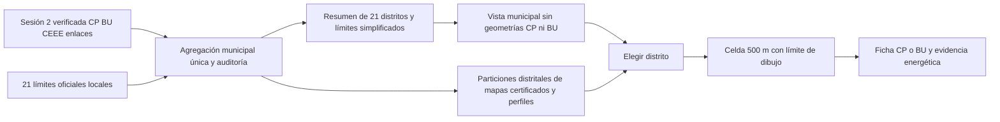

# Sesión 7 — expansión a Madrid capital

Implementación local municipal con 21 distritos seleccionables, productos analíticos y visuales por distrito, vista general pequeña, detalle por celda y comparación territorial. Se reutilizan capturas y lógica auditadas; no se descargan de nuevo Catastro/CEEE ni se reemplazan productos previos. Salida vigente: `data/processed/session_7_final/`. `app.py` abre ahora Madrid capital; `MADRID_REHAB_PILOT=1` conserva el piloto histórico.

## Fuentes y cobertura comprobadas

CP 141.244 filas, 140.595 referencias; BU 124.396; CEEE 115.664. Catastro procede del paquete municipal 28900, INE 28079, fecha ATOM 21/08/2026 y capturas 22/10/2026. CEEE: recursos 2025 y 2026, filtro literal normalizado MADRID, capturas 22/10/2026. Se verificaron nuevamente literales y códigos municipales de las 115.664 filas CEEE y su identidad frente a sesión 2. Todos los CP/BU declaran 28079 y CRS EPSG:25830. Estas evidencias acreditan el ámbito de captura, no exhaustividad del parque real ni de sus certificados.

Límites: Ayuntamiento de Madrid, [catálogo Distritos municipales de Madrid](https://datos.madrid.es/dataset/300497-0-distritos-municipales-madrid), CC BY 4.0, servicio `https://sigma.madrid.es/hosted/rest/services/CARTOGRAFIA/LIMITES_ADMINISTRATIVOS/MapServer`, capa 26. Captura local 22/10/2026 20:11:48 UTC, GeoJSON con `outSR=4326`, reproyectado a 25830. Se verifican hash, 21 códigos exactos 01–21, nombres, polígonos válidos y ausencia de solapamientos. El catálogo fue consultado en esta sesión; no se hizo otra descarga. No se interpreta captura como fecha de vigencia administrativa.

Reproducción de primera captura, solo si faltara y con red disponible:

```bash
PYTHONPATH=src .venv/bin/python -m madrid_rehab.districts --raw-dir data/raw/session_2/districts
```

Los metadatos oficiales locales también enumeran capas BARRIOS (17 y 25), pero su equivalencia, vigencia, licencia concreta y esquema no se han contrastado para esta expansión. No se descargaron ni inventaron barrios. Integración futura: contrato de unidad administrativa con código, distrito padre, geometría/CRS, versión y procedencia; validar catálogo correspondiente antes de elegir capa. Prioridad de esta sesión: los 21 distritos.

La política espacial usa punto interior; conserva cruces, puntos compartidos ambiguos y fuera de límite. No duplica por intersección. RC repetidas con distritos discrepantes permanecen residuales. Véase [calidad municipal](calidad_sesion_7.md) para todos los denominadores, no aditividad y limitaciones.

## Ejecución reproducible

No hay dependencias nuevas ni pasos de compilación. Instalación y tests del proyecto se mantienen:

```bash
.venv/bin/python -m pip install -r requirements.lock
# Datos locales; salida nueva obligatoria:
PYTHONPATH=src .venv/bin/python -m madrid_rehab.city_pipeline --city madrid --district all
PYTHONPATH=src .venv/bin/python -m madrid_rehab.city_pipeline --district chamberi --output-dir data/processed/session_7_chamberi_02
PYTHONPATH=src .venv/bin/python -m madrid_rehab.city_pipeline --district 11 --output-dir data/processed/session_7_carabanchel_01
# Replay municipal:
PYTHONPATH=src .venv/bin/python -m madrid_rehab.city_pipeline --district all --output-dir data/processed/session_7_replay_02
# Visor principal:
PYTHONPATH=src .venv/bin/python -m streamlit run src/madrid_rehab/app.py --server.address 127.0.0.1 --server.port 8512 --server.headless true --browser.gatherUsageStats false
```

`--input-dir` apunta por defecto a sesión 2; `--boundary-dir`, a captura oficial local. `--district` admite all, código con/sin cero y nombre sin acentos. Una ejecución de un distrito conserva el resumen y auditoría municipal para contexto, pero genera detalle/analítica particionada solo para ese distrito; `available_districts` declara disponibilidad. `MADRID_REHAB_SESSION7_DIR` selecciona otra salida en el visor. Una ruta existente se rechaza; no se borran salidas. Los checkpoints iniciales `session_7` y `session_7_madrid` permanecen separados de la salida final.

Pruebas y rendimiento:

```bash
PYTHONPATH=src .venv/bin/python -m unittest discover -s tests -v
PYTHONPATH=src .venv/bin/python -m unittest discover -s tests -p 'test_city_*.py' -v
.venv/bin/ruff check src tests
PYTHONPATH=src .venv/bin/python tests/benchmark_session7.py
```

Los scripts históricos de navegador requieren `MADRID_REHAB_PILOT=1` al lanzar su servidor. No se ejecutan contra la portada municipal como si fueran aceptación de sesión 7.

## Arquitectura y productos

`city_pipeline.py` verifica fuentes, reproduce asignación espacial, agrega una vez el universo municipal y genera particiones. Reutiliza `features`, `profiles`, `analytics`, `event_features`, `districts` y normalización existentes. `territory.py` encapsula propietarios territoriales de RC, malla, alias y evidencia territorial de eventos. `city_audit.py` reconcilia granos y estados. `city_store.py` verifica lecturas de nombres fijos. `city_maps.py` y `district_view.py` implementan navegación y detalle; `city_app.py` es la portada/comparación, llamada por el acceso principal existente. No hay PostGIS, servidor de teselas ni infraestructura nueva.



Raíz: `district_summary.parquet/csv`, `districts.parquet` (21 geometrías simplificadas a 5 m solo para vista), `source_coverage.json`, `reconciliation.json`, `quality_links.parquet`, `unassigned_parcels.parquet`, features/observaciones del ámbito solicitado, benchmark y manifiesto municipal.

`districts/XX/`: features, observaciones energéticas, sensibilidad, periodos/cobertura/auditoría, copias visuales CP/BU, certificados, contextos, enlaces y manifiesto propio compatible con el lector analítico v2. CP/BU originales permanecen en sesión 2. Copias de visualización se simplifican a 0,25 m preservando topología; si cambia área más del 1% o la geometría falla, se conserva la original. Transformación/GeoJSON vectorizados; no se duplica Python por distrito.

La portada lee dos Parquet pequeños y dos JSON; nunca el detalle municipal. La selección carga cinco productos de un distrito y su perfil particionado. Cachés limitadas e invalidadas por tamaño/mtime/ctime de productos/manifiestos, con SHA-256 al cargar y comprobación del manifiesto distrital contra el municipal. Cambios durante lectura abortan. Las cachés devuelven copias. No hay recálculo de Parquet en la aplicación.

Mapa detallado: una celda a la vez y tope de 2.500 unidades CP/BU, declarado en pantalla. Cualquier truncamiento es determinista y visible; las métricas del distrito conservan todo el filtro. La búsqueda por RC/BU recorre el distrito y cambia de celda. Una celda no se anuncia como todo el distrito. Se conserva OSM opcional/offline y selección por ID; un cambio de distrito/filtros invalida selecciones excluidas. CP y BU se distinguen en capas y fichas, sin promover parcela a edificio.

El perfil conserva filtros AND, ordenación, CSV con neutralización de fórmulas, explicación individual, distribución por ámbitos/letras y año, contextos constructivos, comparaciones por periodo/malla y sensibilidad. Gráficos de más de 5.000 puntos se agregan explícitamente por periodos/bandas, con conteos reales; no se selecciona una muestra favorable. La comparación de distritos permite elegir varios, filtrar cobertura y ordenar; incluye letras desconocidas y ámbitos declarados. No es ranking de necesidad.

## Eventos y futuras ciudades

No se incorporaron datos reales nuevos ITE/IEE/subvenciones. Las opciones `--inspections-dir`/`--grants-dir` mantienen manifiestos, hash CP idéntico, deduplicación, fases y exclusión de conflictos. `event_territories` separa localización confirmada por CP, municipio/distrito declarados y ausencia de evidencia; las columnas `verified_*` no se rellenan a partir de una mera declaración territorial. CP antiguas sin distrito siguen admitidas y no inventan distrito. No se confirma edificio físico.

Los agregadores usan claves territoriales y referencia, sin nombres de distrito codificados en fórmulas. La CLI soporta explícitamente solo Madrid. Otra ciudad requiere configuración oficial de municipio/paquetes, patrón de códigos territoriales, CRS/envolvente, límites y licencia, además de validar correspondencias y datos fuente. No se promete soporte de otra ciudad cambiando solo el nombre.

## Regresión y validación

Chamberí: 3.790 referencias, 3.761 BU y 5.105 registros confirmados. Se comparan las 47 columnas previas, identidades de registros y BU. No hay cambio en los indicadores compartidos; las columnas anuales nuevas con ceros solo estabilizan el esquema municipal. Los controles históricos se conservan mediante el acceso explícito al piloto en sus helpers de prueba.

La evidencia de tests, replay, benchmark e integridad se guarda en `reports/session_7/`, fuera de Git. El servidor se intentó en sesión 7 y falló al crear el socket local (`PermissionError: Operation not permitted`). No se reintentó Chromium bloqueado ni descargas de navegadores. AppTest construye el visor y prueba rutas/estados; no verifica dibujo WebGL, clic real, teselas, contraste o fluidez. Esas comprobaciones quedan pendientes y no se presentan como superadas.

## Cobertura observada de los 21 distritos

| Código | Distrito | RC analíticas | CP espaciales | BU espaciales | CEEE confirmados | RC con CEEE |
| --- | --- | --- | --- | --- | --- | --- |
| 01 | Centro | 6.899 | 6.901 | 6.819 | 6.304 | 3.065 |
| 02 | Arganzuela | 2.660 | 2.660 | 2.459 | 4.486 | 1.522 |
| 03 | Retiro | 2.238 | 2.238 | 2.150 | 3.660 | 1.163 |
| 04 | Salamanca | 5.041 | 5.041 | 4.965 | 5.414 | 2.419 |
| 05 | Chamartín | 6.584 | 6.591 | 6.271 | 5.328 | 2.211 |
| 06 | Tetuán | 6.982 | 6.986 | 6.620 | 6.310 | 2.973 |
| 07 | Chamberí | 3.790 | 3.790 | 3.761 | 5.105 | 2.105 |
| 08 | Fuencarral - El Pardo | 12.248 | 12.295 | 9.259 | 7.111 | 2.769 |
| 09 | Moncloa - Aravaca | 10.427 | 10.432 | 9.444 | 4.791 | 2.490 |
| 10 | Latina | 9.310 | 9.322 | 8.648 | 7.343 | 3.893 |
| 11 | Carabanchel | 10.018 | 10.024 | 9.439 | 8.786 | 4.577 |
| 12 | Usera | 6.515 | 6.517 | 6.313 | 4.435 | 2.447 |
| 13 | Puente de Vallecas | 11.215 | 11.218 | 10.597 | 8.267 | 4.344 |
| 14 | Moratalaz | 1.887 | 1.889 | 1.790 | 2.277 | 861 |
| 15 | Ciudad Lineal | 7.227 | 7.231 | 6.939 | 8.521 | 3.801 |
| 16 | Hortaleza | 9.961 | 9.970 | 8.820 | 6.737 | 2.918 |
| 17 | Villaverde | 5.319 | 5.370 | 4.399 | 4.543 | 2.237 |
| 18 | Villa de Vallecas | 5.150 | 5.226 | 3.250 | 3.288 | 1.252 |
| 19 | Vicálvaro | 5.251 | 5.279 | 2.651 | 2.623 | 1.147 |
| 20 | San Blas - Canillejas | 8.181 | 8.204 | 6.787 | 6.263 | 2.949 |
| 21 | Barajas | 3.654 | 4.045 | 3.011 | 1.478 | 715 |

CEEE = registros únicos confirmados en parcela dentro del distrito, no certificados de edificio completo. La suma distrital es 113.070; dos registros/parcelas con RC confirmada no tienen distrito. Los 38 RC residuales completan el universo municipal. CP espaciales conservan multiplicidad geométrica y no coinciden necesariamente con RC analíticas.

## Benchmark de generación real

Procesamiento y auditoría municipal: 41.58 s. Generación de cada distrito: 0.64–2.31 s. Ejecución completa: 67.46 s. RSS máxima del proceso: 1335.5 MiB. Incluye datos municipales reales y comprobación espacial; no es estimación sintética.

Las primeras ejecuciones variaron por caché del sistema y carga concurrente. No se vació la caché global del sistema. Frío en el benchmark del visor significa sin caché de aplicación, no disco físicamente frío. El benchmark del visor y su resumen de aceptación se documentan tras ejecutar el cierre sin procesos de generación concurrentes.

## Benchmark de lectura y representación Python — aceptación

| Operación real | Resultado observado |
| --- | ---: |
| Carga inicial municipal verificada | 0.0329 s |
| Carga municipal en caché, mediana de cinco llamadas | 0.00088 s |
| JSON de mapa municipal | 251,181 bytes |
| Carga inicial de distrito, rango 21 distritos | 0.030–0.154 s |
| Lectura caliente de distrito (copia de caché) | 0.015–0.104 s |
| Filtrado de BU/CEEE distrital | 0.026–0.181 s |
| Serialización detalle de celda | 0.014–0.061 s |
| JSON de celdas por defecto | 0.72–2.44 MB |
| RSS pico del proceso de benchmark del visor | 562.7 MiB |

Cero lecturas Parquet en todas las llamadas calientes verificadas. Caché evita E/S y verificación repetida; deserializar copias grandes puede costar tanto como una lectura con caché del sistema y no se promete aceleración de todas las operaciones. El rango de memoria profunda de los frames detallados es 9.4–42.3 MiB; no incluye todos los buffers nativos anidados, por lo que también se informa RSS. No mide concurrencia de usuarios, GPU, teselas ni latencia percibida.

En Chamberí, filtrado municipal particionado observado: 0.085 s para los mismos 3.761 BU y 5.105 registros del piloto, frente a 0,37–0,43 s en mediciones previas con contextos municipales completos. Es comparación indicativa de entorno/cohorte, no ensayo controlado. La carga analítica sesión 6 (0,174/0,005 s) y la portada municipal actual leen productos distintos y no se equiparan como mejora algorítmica. El dibujo actual por celdas contiene un subconjunto explícito; sus bytes no se comparan como si fueran el mapa completo anterior.

## Cierre de calidad y aceptación

174 pruebas unittest/AppTest superadas (142 anteriores y 32 nuevas), incluidos todos los distritos, selección positiva CP/BU, navegación, estados vacíos/combinados, CSV, caché, integridad, geometrías y denominadores. Ruff y formato revisados; detalle final en `avance_sesion_7.md`. Replay: 261 archivos deterministas idénticos byte a byte; se excluyen tiempos y manifiesto municipal que contiene hash del benchmark. La partición 07 coincide íntegra con ejecución independiente `--district chamberi`; las 47 columnas históricas se mantienen. Originales y sesiones 1/2/6 auditada intactos por hash. No hay commits ni push.

Aceptación pendiente exclusivamente en navegador: clic real municipal y CP/BU, cámara/legibilidad, OSM y offline, búsquedas/cambio de celda, CSV en hoja de cálculo, leyendas y fluidez. El servidor no puede abrir socket en este sandbox. La adquisición de ITE/IEE/ayudas se mantiene para una sesión posterior; no bloquea el alcance catastral/energético municipal entregado.
